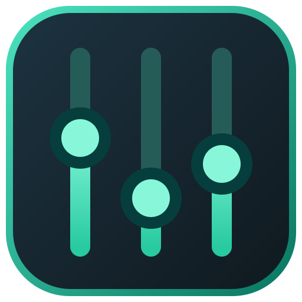
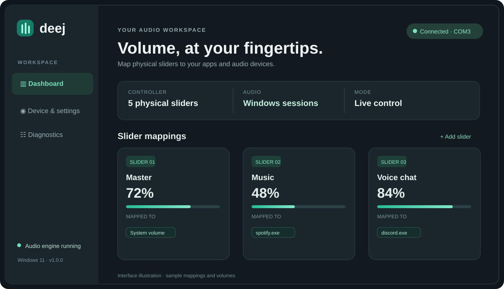

<p align="center"></p>
<h1 align="center">deej for Windows 11</h1>
<p align="center"><strong>Physical sliders. Instant Windows audio control. One modern app.</strong></p>
<p align="center">A modern Windows 11 edition of <a href="https://github.com/omriharel/deej">Omri Harel's original deej</a>, featuring a responsive audio engine, built-in settings dashboard and automatic USB reconnect after sleep.</p>
<p align="center"><a href="https://github.com/Nated4wgy/deej-updated/releases/latest"><strong>Download for Windows</strong></a> &nbsp;·&nbsp; <a href="#get-started">Get started</a> &nbsp;·&nbsp; <a href="#build-from-source">Build from source</a> &nbsp;·&nbsp; <a href="docs/windows11-sleep-wake.md">Sleep/wake recovery</a></p>



<sub>Dashboard illustration based on the current interface. Positions and app assignments are examples, not a live screenshot.</sub>

## Why deej?

Turn inexpensive Arduino sliders or knobs into independent controls for Windows applications and audio sessions. Keep your music, voice chat and games at the right levels without tabbing out.

| | |
|---|---|
| 🎚️ **Live physical mixing** | Control the master mix, microphone, Windows sounds or individual app processes; supports up to 32 sliders. |
| 🖥️ **Built-in dashboard** | View live slider positions, select running applications and devices, change preferences and inspect diagnostics. |
| ⚡ **Responsive audio** | Latest slider values win; the audio worker runs independently from the settings interface. |
| 🔄 **Windows 11 recovery** | Reconnects after wake, retries unavailable COM ports and detects stalled serial streams. |
| 💾 **Safer settings** | Atomic YAML saves, backup and restore, external-edit detection and quick access to advanced config. |
| 🟢 **Portable, single EXE** | No separate settings executable or local web server. Runs in the tray and can start with Windows. |

## See it in action

<table><tr><td width="50%"><sub>DIY slider controller example from the original deej project.</sub></td><td width="50%"><sub>Another physical controller example. Hardware is built separately and connected by USB.</sub></td></tr></table>

## Get started

1. **Download** the latest Windows ZIP from [GitHub Releases](https://github.com/Nated4wgy/deej-updated/releases/latest).
2. **Extract** it to a writable folder, such as `Documents\deej`. Do not install under `Program Files` unless you separately configure a writable settings location.
3. **Connect** your Arduino/compatible slider controller by USB. Upload compatible deej firmware if you haven't already; an example sketch lives in [arduino/deej-5-sliders-vanilla](arduino/deej-5-sliders-vanilla).
4. **Run `deej.exe`**. The mixer starts in the system tray and opens the Settings dashboard.
5. **Select the COM port and firmware baud rate**, then map each slider to a Windows audio target. Save and move a slider to test it.

The dashboard uses Microsoft's **WebView2 Runtime**, normally present on Windows 11. If it is missing, install the [Evergreen WebView2 Runtime](https://developer.microsoft.com/en-us/microsoft-edge/webview2/). The mixer still runs independently in background mode.

### Choose what a slider controls

| Target | Effect |
|---|---|
| `master` | Windows master/output volume |
| `system` | System sounds |
| `mic` | Microphone/input volume |
| `deej.current` | App currently in the foreground |
| `deej.unmapped` | Audio sessions not assigned to another slider |
| `spotify.exe`, `discord.exe`, etc. | Individual applications |
| Device friendly name | Audio session identified by its Windows device name |

You can assign multiple applications to one slider. Applications may need to create an audio session before Windows can adjust their session volume.

### Configuration

The dashboard writes `config.yaml` alongside the executable, retaining unknown YAML keys. The old scalar and list forms both work:

```yaml
slider_mapping:
  0: master
  1: [spotify.exe, firefox.exe]
  2: discord.exe
  3: deej.current
com_port: COM3
baud_rate: 9600
invert_sliders: false
noise_reduction: default
```

Slider indexes start at **0 in YAML** but are numbered from **1 in the interface**. Use your own Windows COM port, not necessarily COM3. A valid config is backed up to `config.yaml.bak` before being replaced. See [the detailed application guide](docs/unified-app.md) for editing, restore and process behaviour.

## Sleep/wake and USB recovery

On Windows 11, deej listens for resume notifications and requests a fresh serial connection without restarting the audio engine. It also retries when a COM port isn't ready, detects a previously active controller that stops delivering valid frames and offers **Reconnect controller** from the tray.

If a USB device reappears under a **different COM port**, update the port in Settings. See [recovery details and hardware test steps](docs/windows11-sleep-wake.md).

## Running modes

```text
deej.exe                     Start mixer and open the dashboard
deej.exe --background        Run quietly in the tray
deej.exe --settings          Open Settings without starting another mixer
deej.exe --check-config      Validate config.yaml without starting
deej.exe --config C:\path\config.yaml
```

Closing the dashboard **does not close the mixer**. Reopen Settings from the tray; deej keeps mixing audio in a separate runtime role. Themes include light and dark mode.

## Build from source

**Windows amd64** is the packaged release target. Install Go (the exact version configured in [Windows CI](.github/workflows/windows.yml)) and Git. Production builds use pure Go and do not require GCC. Node 22+ is only needed for dashboard tests.

```powershell
git clone https://github.com/Nated4wgy/deej-updated.git
cd deej-updated
.\scripts\build_windows.ps1
```

The script generates the Windows icon and manifest resources, verifies dependencies, runs Go tests and vet, and creates `bin\deej.exe`, a starter config, license/notice files, build identity and SHA-256 checksums. It will not overwrite an existing `bin\config.yaml`.

Optional dashboard checks:

```powershell
npm ci
npm test
```

Windows builds, dashboard tests and race detection run on [GitHub Actions](https://github.com/Nated4wgy/deej-updated/actions). Keep a backup of your current configuration when upgrading.

## Learn more

- [Building a controller and original deej documentation](https://github.com/omriharel/deej)
- [Unified Windows application architecture](docs/unified-app.md)
- [Sleep/wake and serial troubleshooting](docs/windows11-sleep-wake.md)
- [Validation and testing](docs/validation.md)
- [Change history](CHANGELOG.md)
- [Community hardware examples](community.md)

## Credits and license

Based on **[deej by Omri Harel](https://github.com/omriharel/deej)**, with appreciation for the original project and community builds. This Windows 11 edition adds the unified dashboard, responsive mixing improvements, Windows serial recovery and revised branding. Distributed under the same [MIT License](LICENSE). Third-party notices are in [THIRD-PARTY-NOTICES.txt](THIRD-PARTY-NOTICES.txt).
